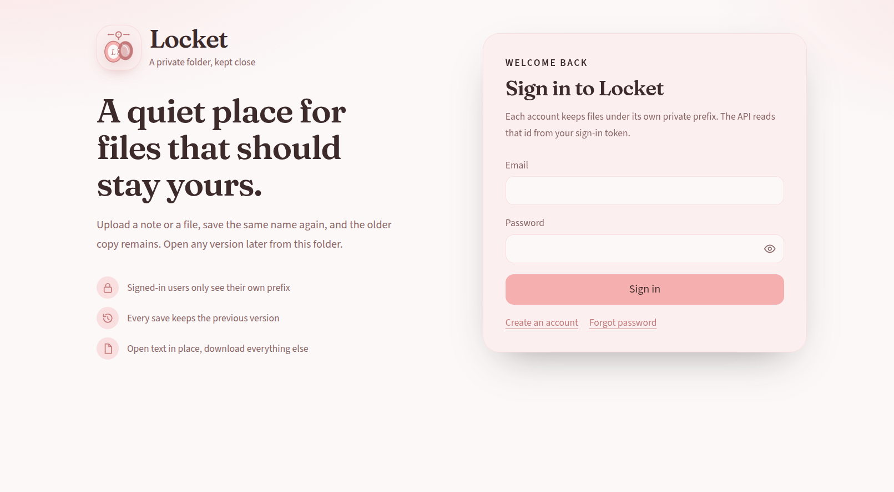
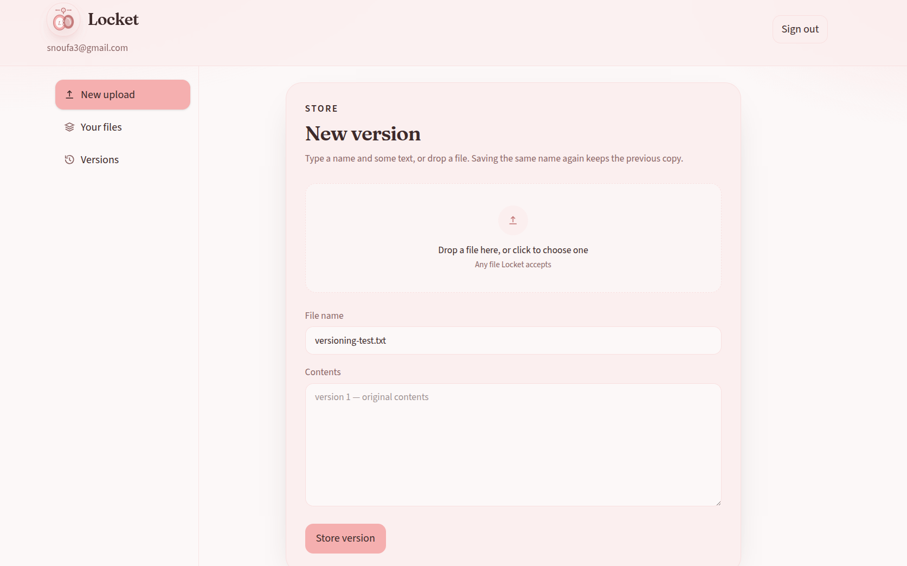
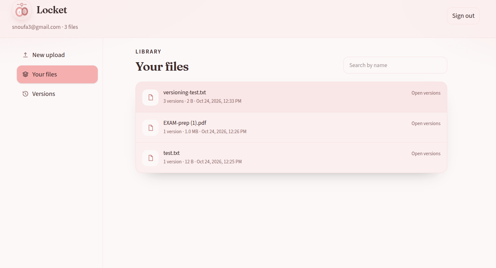
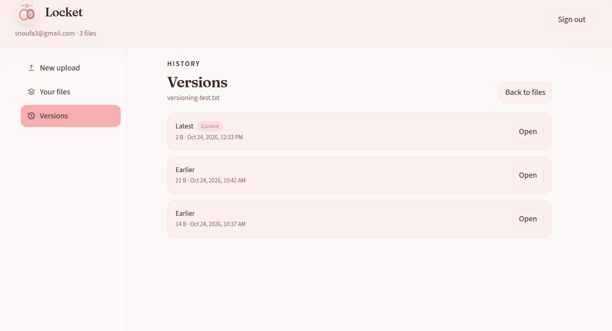

# Locket

A private file folder backed by Amazon S3. Each signed-in person only sees files under their own prefix. Saving the same name again keeps the older copy, and you can open it later from Versions.

The browser app is called **Locket**. The AWS stack is **s3-file-vault**.

## Screenshots

Sign in to your private folder.



Store text or drop a file. Saving the same name again keeps the previous copy.



Pick a file from your library.



Open the latest copy or an earlier one.



## What it does

- Sign up, confirm email, sign in, and reset a password through Amazon Cognito
- Store text or a file under `vault/<your user id>/`
- List your files and how many versions each one has
- Open an earlier version (text in the page, everything else as a download)
- Keep object access inside a VPC: the API runs in a private subnet and reaches S3 through a gateway endpoint

## How it fits together

```
Locket (Next.js)  →  Cognito (sign-in)
                 →  API Gateway (JWT authorizer)  →  Lambda  →  assume-role session  →  S3 + KMS
```

The API reads `sub` from the ID token. A user id in the request body is ignored. Keys are always `vault/<sub>/<file name>`.

The Lambda role can only assume `s3-file-vault-access`. Each request attaches a session policy for that person's prefix and the vault KMS key.

See [docs/architecture.md](docs/architecture.md) for the full path, VPC endpoints, and bucket rules.

## Repository

| Path | What it is |
| --- | --- |
| `web/` | Next.js app (Locket) |
| `api/` | Lambda that lists, stores, and reads objects |
| `template.yaml` | SAM template: bucket, KMS, Cognito, HTTP API, VPC wiring |
| `docs/` | Architecture notes, policy, and test notes |
| `public/` | App screenshots used in this README |
| `sts-dns/` | Helper used when STS private DNS is not available in the VPC |

## Prerequisites

- Node.js 20 or newer
- An AWS account and the [AWS SAM CLI](https://docs.aws.amazon.com/serverless-application-model/latest/developerguide/install-sam-cli.html) if you are deploying the stack
- A Cognito app client id and the HTTP API URL after deploy

## Run the app

```bash
cd web
npm install
npm run dev
```

Open [http://localhost:3000](http://localhost:3000).

Create `web/.env.local` with:

```bash
NEXT_PUBLIC_API_URL=https://your-api-id.execute-api.us-east-1.amazonaws.com
NEXT_PUBLIC_COGNITO_CLIENT_ID=your-cognito-app-client-id
NEXT_PUBLIC_AWS_REGION=us-east-1
```

Restart `npm run dev` after changing env vars.

Passwords must be at least 12 characters and include upper case, lower case, a number, and a symbol.

Try this after sign-in:

1. Open **New upload**, store a name and some text
2. Store the same name again with different text
3. Open **Your files**, then **Versions**, and open the earlier copy

## Deploy the stack

From the repository root:

```bash
sam build
sam deploy
```

`samconfig.toml` uses stack name `s3-file-vault` in `us-east-1`.

Useful parameters in `template.yaml`:

- `ObjectPrefix` — prefix the access role may use (default `vault`)
- `TrustedPrincipalArn` — who may assume the access role (optional)
- `AdminPrincipalArn` — who may manage the bucket from outside the VPC endpoint

After deploy, copy the HTTP API URL and Cognito client id into `web/.env.local`.

The file vault bucket name is `s3-file-vault-<account-id>`. It blocks public access, has versioning on, and encrypts objects with SSE-KMS (`alias/s3-file-vault`). `temporary/` expires after 7 days. `vault/` does not.

## API

Every route except CORS preflight needs `Authorization: Bearer <Cognito ID token>`.

| Method | Path | Purpose |
| --- | --- | --- |
| `GET` | `/status` | Check that the API can assume a vault session |
| `GET` | `/objects` | List files in your prefix |
| `POST` | `/objects` | Store text (`name`, `content`) or a file (`name`, `contentBase64`, `contentType`) |
| `GET` | `/versions?key=` | List versions for one key |
| `GET` | `/content?key=&versionId=` | Read one version |

The Next.js route `web/src/app/api/auth/route.ts` talks to Cognito for sign-up, confirm, sign-in, and password reset. The browser never sends the password to API Gateway.

## Security notes

- Object and list calls on the vault bucket are denied unless they come through the S3 VPC endpoint (except the admin principal)
- TLS is required
- CloudTrail records data events for the vault bucket
- There is no NAT gateway; STS and logs use interface endpoints

Do not commit `web/.env.local` or other credential files.
