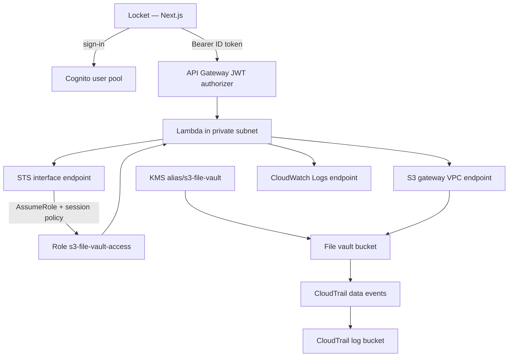

# Locket

A private file folder backed by Amazon S3. Each signed-in person only sees files under their own prefix. Saving the same name again keeps the older copy, and you can open it later from Versions.

The browser app is called **Locket**. The AWS stack is **s3-file-vault**.

## Problem

Shared or public S3 access mixes people together and makes it easy to over-share objects. This project gives each signed-in person a private folder (`vault/<user id>/`), keeps object traffic inside a VPC, encrypts files with a customer-managed KMS key, and uses Cognito so the API never trusts a user id from the request body.

## Screenshots

Sign in to your private folder.


Store text or drop a file. Saving the same name again keeps the previous copy.


Pick a file from your library.


Open the latest copy or an earlier one.


## What it does

- Sign up, confirm email, sign in, and reset a password through Amazon Cognito
- Store text or a file under `vault/<your user id>/`
- List your files and how many versions each one has
- Open an earlier version (text in the page, everything else as a download)
- Keep object access inside a VPC: the API runs in a private subnet and reaches S3 through a gateway endpoint

## Architecture

| Service | Why it is here |
| --- | --- |
| Cognito | Sign-up, sign-in, and ID tokens for the browser |
| API Gateway (HTTP API) | JWT authorizer in front of the vault API |
| Lambda | List, store, and read objects for the signed-in user |
| STS AssumeRole | Short-lived session scoped to `vault/<sub>/` and the vault KMS key |
| S3 | Versioned private bucket for vault objects |
| KMS | SSE-KMS encryption for vault objects (`alias/s3-file-vault`) |
| VPC + endpoints | Private subnet; S3 gateway endpoint; STS and CloudWatch Logs interface endpoints (no NAT) |
| CloudTrail | Data events for the vault bucket |



The API reads `sub` from the ID token. A user id in the request body is ignored. Keys are always `vault/<sub>/<file name>`.

The Lambda role can only assume `s3-file-vault-access`. Each request attaches a session policy for that person's prefix and the vault KMS key.

See [docs/architecture.md](docs/architecture.md) for the full path, VPC endpoints, and bucket rules.

## Request flow

1. Browser signs up or signs in with Cognito (password stays on the Next.js auth route, not API Gateway).
2. Browser calls the HTTP API with `Authorization: Bearer <ID token>`.
3. API Gateway validates the JWT; unsigned or wrong-issuer calls get `401`.
4. Lambda reads `sub` from the token, assumes `s3-file-vault-access` with a session policy for `vault/<sub>/` and the vault KMS key.
5. S3 work goes through the VPC gateway endpoint (object/list calls from outside that endpoint are denied, except the admin principal).
6. Overwrites create a new version; earlier bytes stay available by version ID until deleted or (for `temporary/` only) expired by lifecycle.

## Repository

| Path | What it is |
| --- | --- |
| `web/` | Next.js app (Locket) |
| `api/` | Lambda that lists, stores, and reads objects |
| `template.yaml` | SAM template: bucket, KMS, Cognito, HTTP API, VPC wiring |
| `docs/` | Architecture notes, policy, and test notes |
| `public/` | App screenshots used in this README |
| `sts-dns/` | Helper used when STS private DNS is not available in the VPC |

## Prerequisites

- Node.js 20 or newer
- An AWS account and the [AWS SAM CLI](https://docs.aws.amazon.com/serverless-application-model/latest/developerguide/install-sam-cli.html) if you are deploying the stack
- A Cognito app client id and the HTTP API URL after deploy

## Run the app

```bash
cd web
npm install
npm run dev
```

Open [http://localhost:3000](http://localhost:3000).

Create `web/.env.local` with:

```bash
NEXT_PUBLIC_API_URL=https://your-api-id.execute-api.us-east-1.amazonaws.com
NEXT_PUBLIC_COGNITO_CLIENT_ID=your-cognito-app-client-id
NEXT_PUBLIC_AWS_REGION=us-east-1
```

Restart `npm run dev` after changing env vars.

Passwords must be at least 12 characters and include upper case, lower case, a number, and a symbol.

Try this after sign-in:

1. Open **New upload**, store a name and some text
2. Store the same name again with different text
3. Open **Your files**, then **Versions**, and open the earlier copy

## Deploy the stack

From the repository root:

```bash
sam validate
sam build
sam deploy
```

`samconfig.toml` uses stack name `s3-file-vault` in `us-east-1`.

Useful parameters in `template.yaml`:

- `ObjectPrefix` — prefix the access role may use (default `vault`)
- `TrustedPrincipalArn` — who may assume the access role (optional)
- `AdminPrincipalArn` — who may manage the bucket from outside the VPC endpoint

After deploy, copy the HTTP API URL and Cognito client id into `web/.env.local`, then confirm:

```bash
# should return 401 without a token
curl -s -o /dev/null -w "%{http_code}\n" "$NEXT_PUBLIC_API_URL/status"
```

Sign in from the app and store a small text object under **New upload**. The file vault bucket name is `s3-file-vault-<account-id>`. It blocks public access, has versioning on, and encrypts objects with SSE-KMS (`alias/s3-file-vault`). `temporary/` expires after 7 days. `vault/` does not.

## Testing

Recorded results from 2026-10-23 are in [docs/test-results.md](docs/test-results.md). Summary:

| Scenario | Result |
| --- | --- |
| Bucket controls (public access, versioning, SSE-KMS, VPC endpoint deny, lifecycle, CloudTrail) | Passed |
| Least privilege on `s3-file-vault-access` (vault allowed; other prefixes and admin APIs denied) | Passed |
| Two Cognito users only see their own folders; spoofed user id in the body is ignored | Passed |
| Overwrite keeps earlier versions; app can open an older version ID | Passed |
| `/status` without a token | `401` |
| Stack teardown | Stack and buckets deleted; KMS key left `PendingDeletion` for the waiting period |

## API

Every route except CORS preflight needs `Authorization: Bearer <Cognito ID token>`.

| Method | Path | Purpose |
| --- | --- | --- |
| `GET` | `/status` | Check that the API can assume a vault session |
| `GET` | `/objects` | List files in your prefix |
| `POST` | `/objects` | Store text (`name`, `content`) or a file (`name`, `contentBase64`, `contentType`) |
| `GET` | `/versions?key=` | List versions for one key |
| `GET` | `/content?key=&versionId=` | Read one version |

The Next.js route `web/src/app/api/auth/route.ts` talks to Cognito for sign-up, confirm, sign-in, and password reset. The browser never sends the password to API Gateway.

## Security

- Object and list calls on the vault bucket are denied unless they come through the S3 VPC endpoint (except the admin principal)
- TLS is required (`DenyInsecureTransport`)
- Cognito JWT authorizer on API routes; Lambda keys off `sub`, not a client-supplied user id
- Per-request STS session policy limits S3 and KMS to that person's prefix
- CloudTrail records data events for the vault bucket
- There is no NAT gateway; STS and logs use interface endpoints
- Cognito holds passwords; do not commit `web/.env.local` or other credential files

## Reliability

- Client or network retries of `POST /objects` with the same name create another S3 version (no client-side idempotency key). The latest version is current; earlier ones remain until deleted
- Input mistakes return `400` with an `InputError` message. Missing routes return `404`. AWS failures surface as `403`/`500` with the AWS error code when available
- API Gateway JWT failures reject the call before Lambda runs
- Versioning is not a backup: deleting a specific version, emptying a versioned bucket, or deleting the stack removes history. `temporary/` can also expire noncurrent versions via lifecycle
- The access role cannot call `s3:DeleteObjectVersion`; a delete without a version ID adds a delete marker rather than erasing prior versions

## Costs and cleanup

Charges can come from:

- S3 storage, version history, and requests (especially if many overwrites keep versions under `vault/`)
- KMS encrypt/decrypt with the customer-managed key (bucket keys reduce call volume)
- VPC interface endpoints for STS and CloudWatch Logs (hourly + data processing)
- Lambda, API Gateway, Cognito MAU, and CloudTrail data-event delivery to the trail bucket

To remove the stack:

```bash
# Empty both versioned buckets first (vault + trail), including all versions and delete markers
sam delete
```

Customer-managed KMS keys are not deleted immediately; they enter a pending-deletion window (often seven days) after the stack is gone. Confirm in the KMS console if you need the key fully removed.
