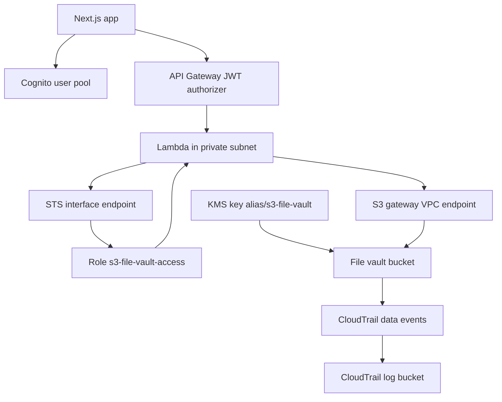

# Architecture

Template `s3-file-vault` for `us-east-1`. The browser signs in with Cognito, calls API Gateway with the ID token, and the Lambda stores each person's files under `vault/<their-user-id>/`.

API Gateway requires a Cognito ID token on every route. The Lambda reads `sub` from that token. A user id or prefix in the request body is ignored. Object keys are `vault//<file name>`.

The API role `s3-file-vault-api` can only call `sts:AssumeRole` on `s3-file-vault-access`. Each request passes a session policy for `vault//` and for the vault KMS key. The access role itself allows the `vault/` prefix, so the session policy is the per-person limit.

The function runs in a private subnet. S3 is reached through the gateway VPC endpoint. STS is reached through an interface endpoint. Private DNS for `sts.us-east-1.amazonaws.com` could not be enabled in this VPC, so the function uses the endpoint hostname. A CloudWatch Logs interface endpoint carries the function logs. There is no NAT gateway.

The file vault bucket blocks public access, has versioning, and uses SSE-KMS (`alias/s3-file-vault`) with a bucket key. Its bucket policy denies non-TLS access and denies object and list calls unless they come from the S3 VPC endpoint. `AdminPrincipalArn` may still manage the bucket from outside that endpoint. `temporary/` expires after 7 days. `vault/` has no expiration rule. The signed-in app writes only under `vault//`.

The CloudTrail log bucket uses SSE-S3. Trail `s3-file-vault-data-events` records data events for the file vault bucket only. Log files under `AWSLogs/` expire after 90 days.
